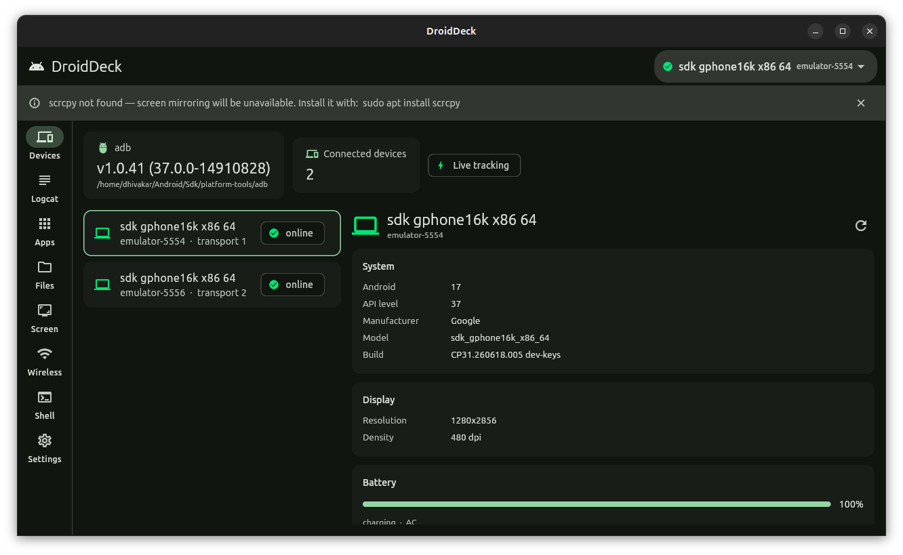
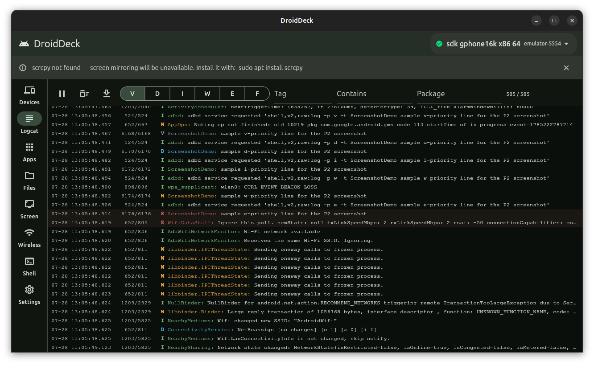
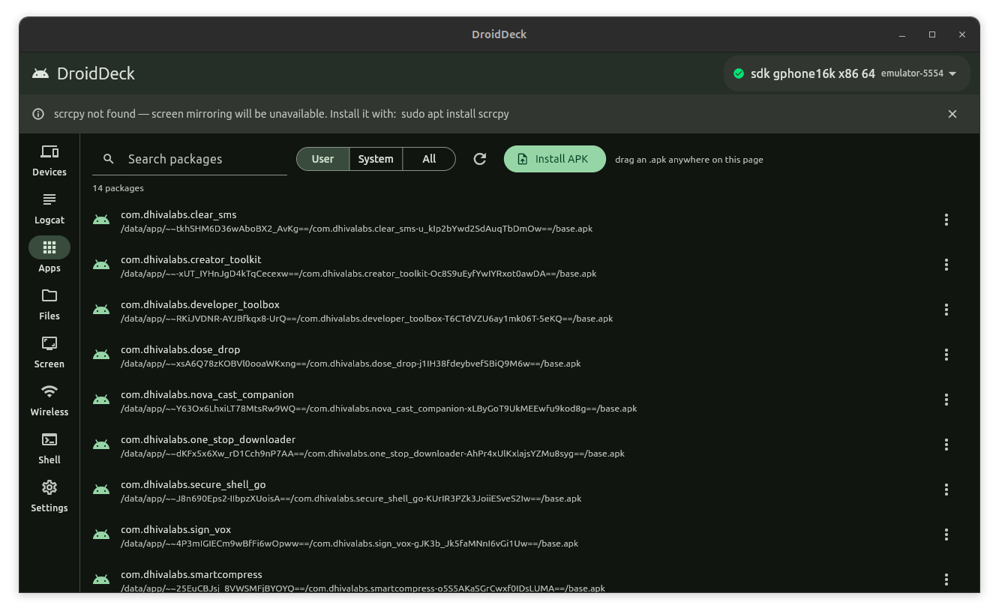
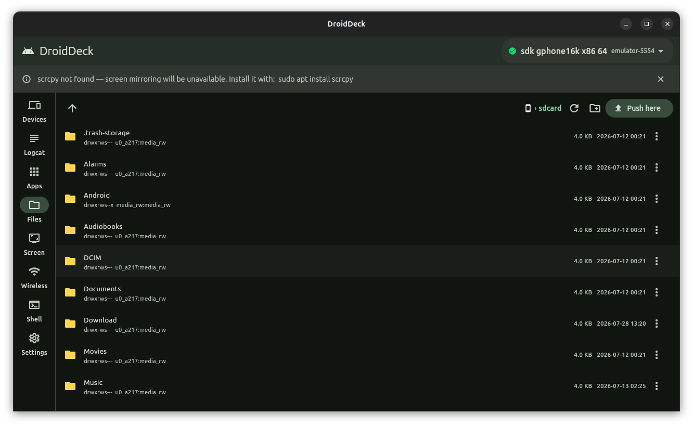
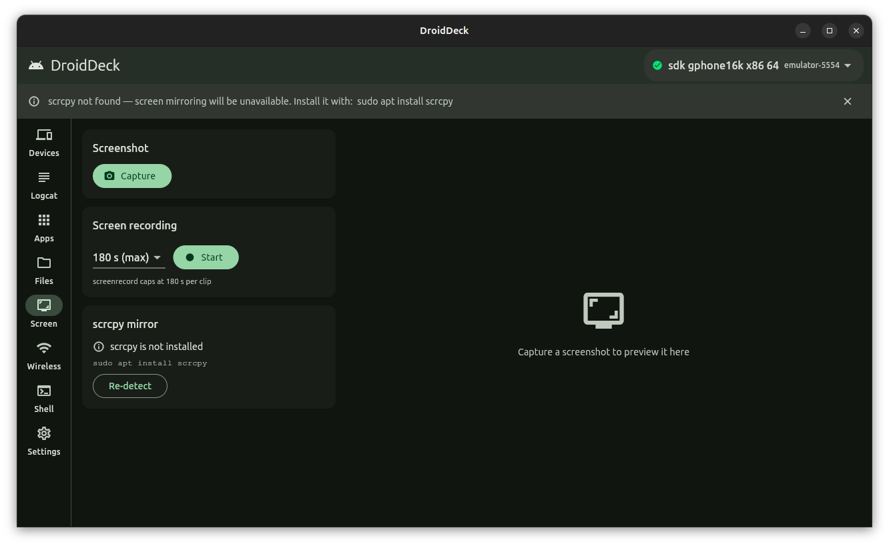
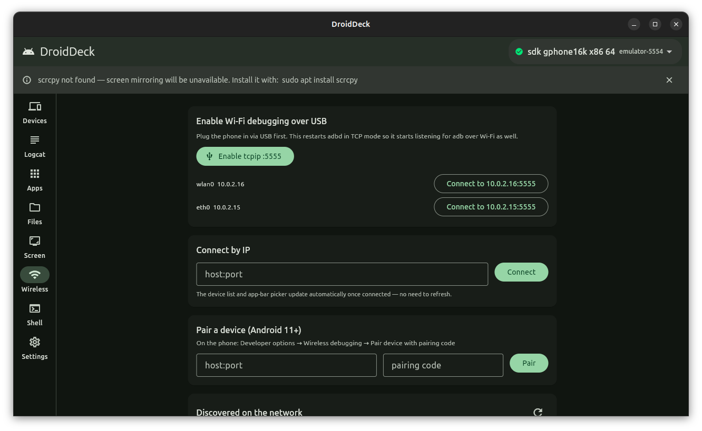
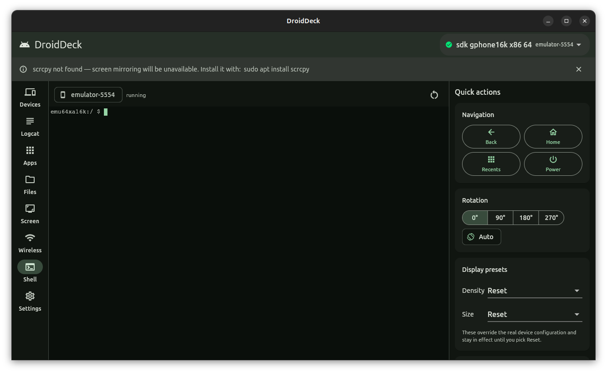

# DroidDeck

[](https://github.com/Dhiva-Labs/DroidDeck/actions/workflows/ci.yml)


**An ADB command center for your Linux desktop.**



DroidDeck wraps `adb` (and, optionally, `scrcpy`) in a polished Material 3 desktop
app: a live device dashboard, logcat viewer, app manager, file explorer, screen
tools, wireless pairing and a real interactive shell — the things you reach for
constantly while shipping an Android app, without leaving a GUI.

## Features

- **Devices** — live device tracking straight off the adb server's
  `track-devices` socket, with a polling fallback if the socket is ever
  unavailable; per-device Android version, battery, resolution/density and IP
  details.
- **Logcat** — streamed `logcat -v threadtime` into a 50k-line ring buffer,
  with priority, tag, free-text and package filters (the package filter
  resolves and tracks that app's live pid).
- **Apps** — package manager with user/system/all views, launch, force-stop,
  clear-data, uninstall, streamed APK install (drag-and-drop or file picker),
  and APK extraction that pulls base **and split** APKs.
- **Files** — a device file explorer with breadcrumb navigation, drag-and-drop
  push, pull to `~/Downloads`, and byte-for-byte reliable transfers
  (checksum-verified push/pull round-trips).
- **Screen** — one-click screenshot capture, `screenrecord` clips stopped
  SIGINT-safe (so the file always stays playable), and an scrcpy launcher with
  quality/latency presets and session tracking.
- **Wireless** — enable `tcpip` over USB, connect by IP, Android 11+ pairing,
  mDNS discovery of devices on the network, and a saved-devices list with
  one-click reconnect.
- **Shell** — a real interactive terminal (`xterm` + a pty-spawned
  `adb shell`) alongside a quick-actions grid: navigation keys, rotation,
  density/size presets, and dumpsys shortcuts.

## Screenshots

| | |
|---|---|
| **Devices**  | **Logcat**  |
| **Apps**  | **Files**  |
| **Screen**  | **Wireless**  |
| **Shell**  | |

## Requirements

- Linux, x86-64 or ARM64
- [`adb`](https://developer.android.com/tools/adb) — part of Android
  platform-tools. DroidDeck looks for it via a Settings override, then
  `$PATH`, then common SDK install locations (e.g.
  `~/Android/Sdk/platform-tools`).
- [`scrcpy`](https://github.com/Genymobile/scrcpy) — optional, only needed for
  screen mirroring.

## Install

**.deb (Debian/Ubuntu), x86-64 and ARM64:**

```sh
sudo dpkg -i droiddeck_1.0.2_amd64.deb    # x86-64
sudo dpkg -i droiddeck_1.0.2_arm64.deb    # ARM64 (aarch64)
```

Build the package yourself with `packaging/build_deb.sh` (see below), or grab
a prebuilt one from this repo's Releases page. The script builds the package
for the architecture of the machine it runs on.

**Build from source:**

```sh
flutter pub get
flutter build linux --release
```

The bundle is written to `build/linux/x64/release/bundle/` on an x86-64
machine and to `build/linux/arm64/release/bundle/` on an ARM64 one — run
`droid_deck` inside it. Flutter cannot cross-compile the Linux desktop target,
so build on a machine of the architecture you want.

## Wireless debugging: connecting a phone

**Android 11+ (pairing-code flow):**

1. On the phone: **Settings → Developer options → Wireless debugging** →
   **Pair device with pairing code**.
2. It shows a `host:port` and a 6-digit code. Enter both into DroidDeck's
   **Wireless** tab, in the **Pair a device** card, and press **Pair**.
3. Pairing uses its own port — go back to the phone's main **Wireless
   debugging** screen for the *connect* port, then use that `host:port` with
   **Connect** in DroidDeck.

**Android 10 and below (USB first):**

1. Plug the phone in over USB with USB debugging enabled, and select it in
   DroidDeck.
2. Press **Enable tcpip :5555** on the Wireless tab.
3. Once adbd restarts in TCP mode, use the one-click **Connect to
   `<ip>:5555`** button that appears next to it.

## Troubleshooting

- **"adb not found."** DroidDeck checks a Settings override first, then
  `$PATH`, then common SDK locations (`~/Android/Sdk/platform-tools`, etc).
  If none of those find it, open **Settings** and point it at your `adb`
  binary directly.
- **`/sdcard` looks like a single link entry instead of a folder.** toybox's
  `ls` only dereferences a symlink argument when it's given a trailing slash —
  DroidDeck already lists device paths that way internally, so this is
  handled; it only bites if you're comparing against a raw `adb shell ls`.
- **A screen recording of an idle screen is a few KB and barely plays.**
  Android's `screenrecord` only emits frames when the screen content changes —
  interact with the device while recording.
- **scrcpy mirroring is unavailable.** Install it with
  `sudo apt install scrcpy`, then press **Re-detect** on the Screen tab (no
  restart needed).

## Development

```sh
flutter test
```

Integration tests drive the real app against a live device, so they need a
booted emulator or attached device visible as `emulator-5554`:

```sh
flutter test integration_test -d linux
```

## Sponsors

Dhiva Labs is an independent, self-funded lab. [Sponsorships](https://github.com/sponsors/Dhiva-Labs) help bring this project and the rest of Dhiva Labs to every platform, iPhone and Mac included.

[](https://github.com/sponsors/Dhiva-Labs)

Monthly sponsors at $10 and up are listed here:

<!-- sponsors -->
*Be the first: [sponsor Dhiva Labs](https://github.com/sponsors/Dhiva-Labs).*
<!-- sponsors -->

## License

MIT — see [LICENSE](LICENSE).

---

A Dhiva Labs project.
